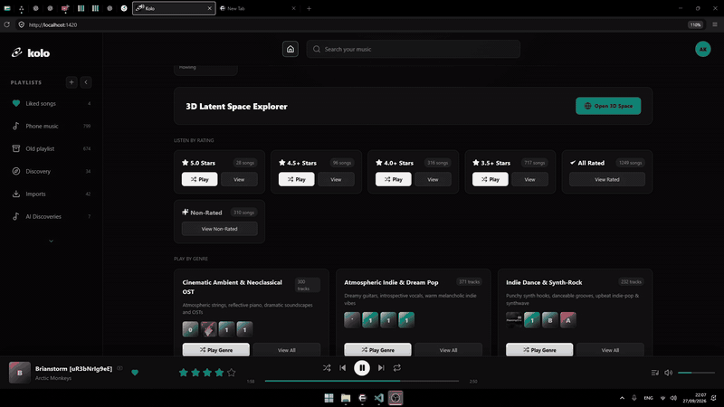
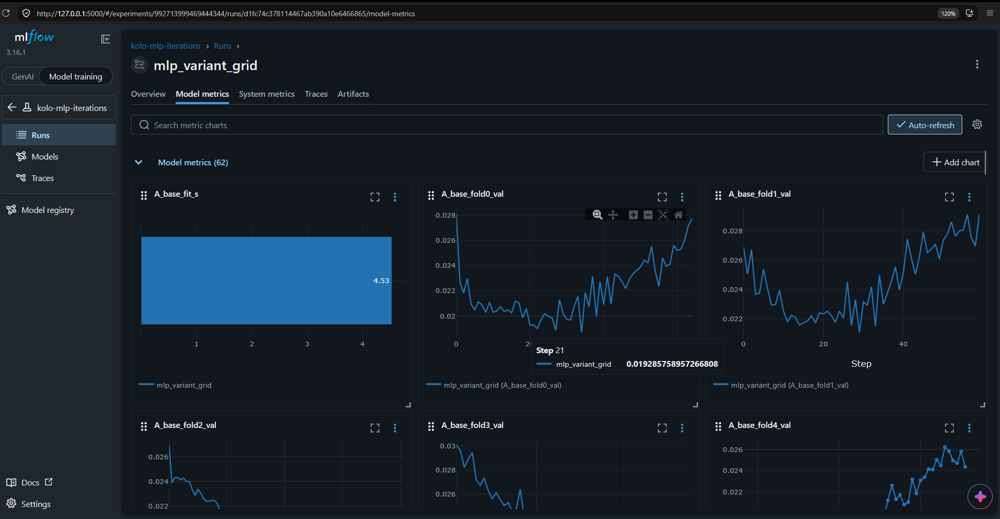
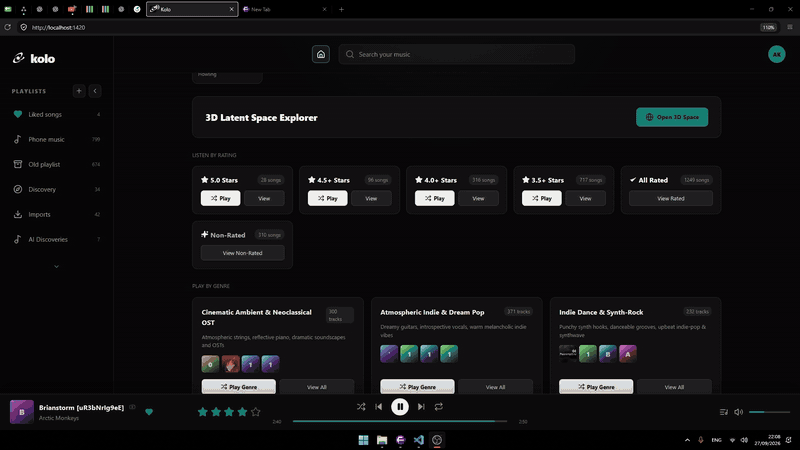

# Kolo

Kolo is my personal project: a local music player and a playground for experiments in personal taste modeling.

I got tired of Spotify recommending music I don't actually like, so, like any sane ML engineer, I decided to build my own Spotify - with some ML experiments and questionable amounts of tinkering along the way.

## Preview
### Taste map



### Experiment tracking



### Desktop player



## Repository layout

| Directory | Contents |
| --- | --- |
| [`kolo.0.data`](kolo.0.data/README.md) | Local audio partitions and generated metadata. Audio, ratings, and embeddings are excluded from Git. |
| [`kolo.1.eda`](kolo.1.eda/README.md) | MuQ-MuLan embedding extraction, clustering, dimensionality reduction, and visualization. |
| [`kolo.2.ml`](kolo.2.ml/README.md) | Rating models, model comparisons, inference, and music-discovery scripts. |
| [`kolo.3.app`](kolo.3.app/README.md) | React/Vite player with an optional Tauri desktop shell. |

The application and the analysis scripts share `kolo.0.data` as their local workspace. User-specific audio and state stay outside version control; placeholder directories preserve the expected layout.

## Current model

The deployed rating model is a voting regressor combining an RBF SVR and Extra Trees. Its latest saved report uses five-fold out-of-fold predictions over 1,208 explicit ratings:

- mean absolute error: **0.472 stars**
- predictions within 0.5 star: **64.8%**
- predictions within 1 star: **90.0%**

See the [rating model report](kolo.2.ml/docs/rating_model_report.md) for the full results and limitations.

## Setup

### Python tools

Python 3.10 or newer and FFmpeg are required. A CUDA-capable GPU is optional but useful when extracting embeddings.

```bash
python3 -m venv .venv
.venv/bin/pip install -r requirements.txt
```

### Player

Node.js 18 or newer is required. Rust is only needed for the Tauri build.

```bash
cd kolo.3.app
./setup.sh
./dev.sh             # browser development server
./dev.sh --desktop   # Tauri development build
```

`./start.sh` builds the frontend and serves a static preview without hot reloading.

## Common tasks

Run repository checks:

```bash
./check.sh
./check.sh --desktop  # also run cargo fmt and cargo check
```

Extract missing embeddings and rebuild the cluster visualizations:

```bash
./kolo.1.eda/run_eda.sh
```

Train the classifier benchmark and rating model:

```bash
./kolo.2.ml/train.sh
```

Score a file, YouTube URL, or directory:

```bash
.venv/bin/python kolo.2.ml/predict.py --input "path/to/song.mp3"
.venv/bin/python kolo.2.ml/predict.py --url "https://www.youtube.com/watch?v=..."
.venv/bin/python kolo.2.ml/predict.py --dir "path/to/album" --save-csv ranked_songs.csv
```

## Documentation

- [Data layout and file formats](kolo.0.data/docs/data_spec.md)
- [Embedding and cluster analysis](kolo.1.eda/docs/vibe_analysis.md)
- [Model evaluation](kolo.2.ml/docs/rating_model_report.md)
- [Desktop app features](kolo.3.app/docs/app_features.md)
- [Desktop app implementation](kolo.3.app/docs/technical_spec.md)
- [Interface design notes](kolo.3.app/docs/design.md)

## License

Source code is available under the [MIT License](LICENSE). Audio files and third-party model weights are not included in that license.
