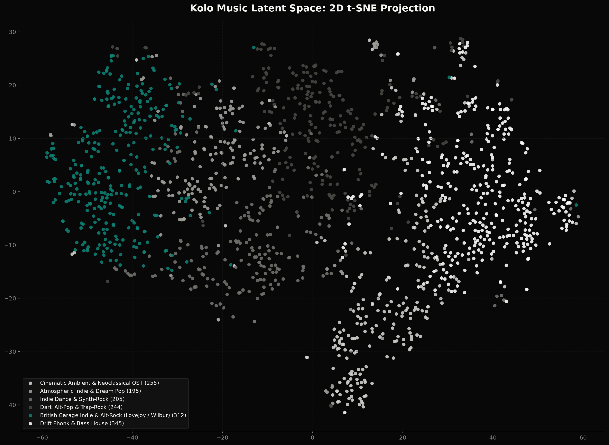
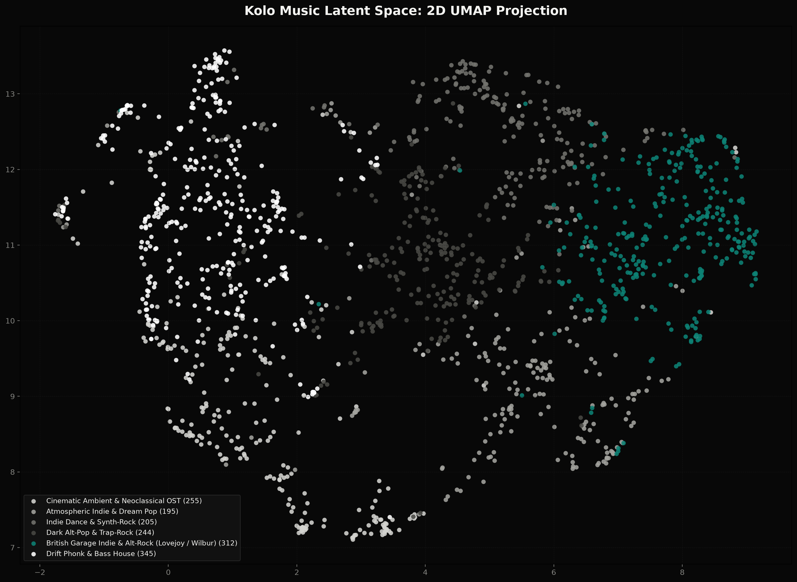
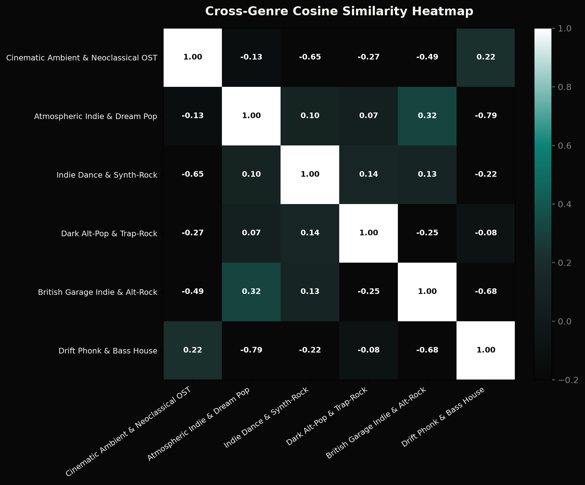

# Audio embedding analysis

This analysis uses 512-dimensional vectors from `OpenMuQ/MuQ-MuLan-large`. It is intended to describe one personal library rather than establish a general genre taxonomy.

## Preprocessing

The script subtracts the library mean and then L2-normalizes each vector:

$$
\tilde{x} = \frac{x - \mu}{\lVert x - \mu \rVert_2}
$$

Mean-centering reduces the common direction present in the raw vectors. K-means is fitted to the centered user-library vectors; tracks from the negative partition are projected afterward and are not used to fit the clusters.

## Projections

The interactive Plotly view is generated at `kolo.3.app/public/cluster_visualization.html` and displayed inside the player. It provides 3D t-SNE and UMAP views plus title search.

## Cluster labels

The current six labels are manual summaries based on tracks near each fitted cluster:

| ID | Label |
| ---: | --- |
| 0 | Cinematic Ambient & Neoclassical OST |
| 1 | Atmospheric Indie & Dream Pop |
| 2 | Indie Dance & Synth-Rock |
| 3 | Dark Alt-Pop & Trap-Rock |
| 4 | British Garage Indie & Alt-Rock |
| 5 | Drift Phonk & Bass House |

These names make the visualization easier to navigate, but K-means does not infer them. Refitting on a substantially different library may require relabeling the resulting cluster IDs.

## Cluster similarity

The heatmap compares normalized K-means centroids. A higher value means the clusters occupy nearby directions in this embedding space; it does not by itself imply a shared genre or causal relationship.

## Limitations

- t-SNE and UMAP preserve local structure imperfectly and should not be read as calibrated distances.
- Different recordings or remixes of the same song can appear as separate points.
- The cluster count is fixed at six for the interface, not selected as a universal optimum.
- Labels reflect the contents of the current library and need review after a large data change.
