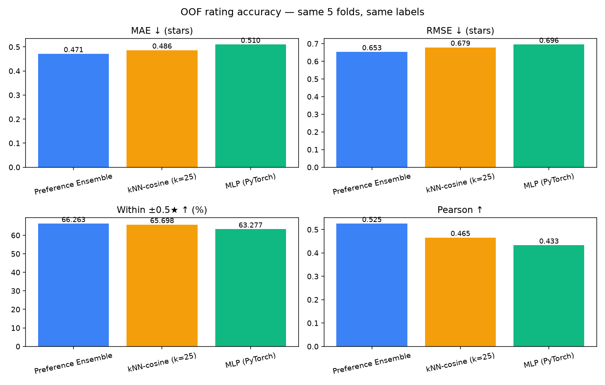
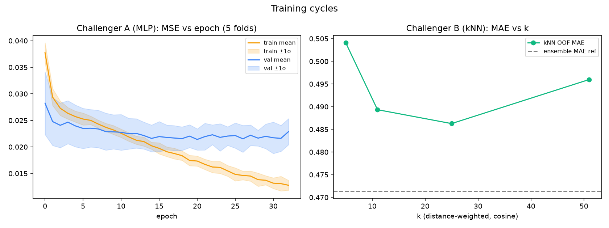
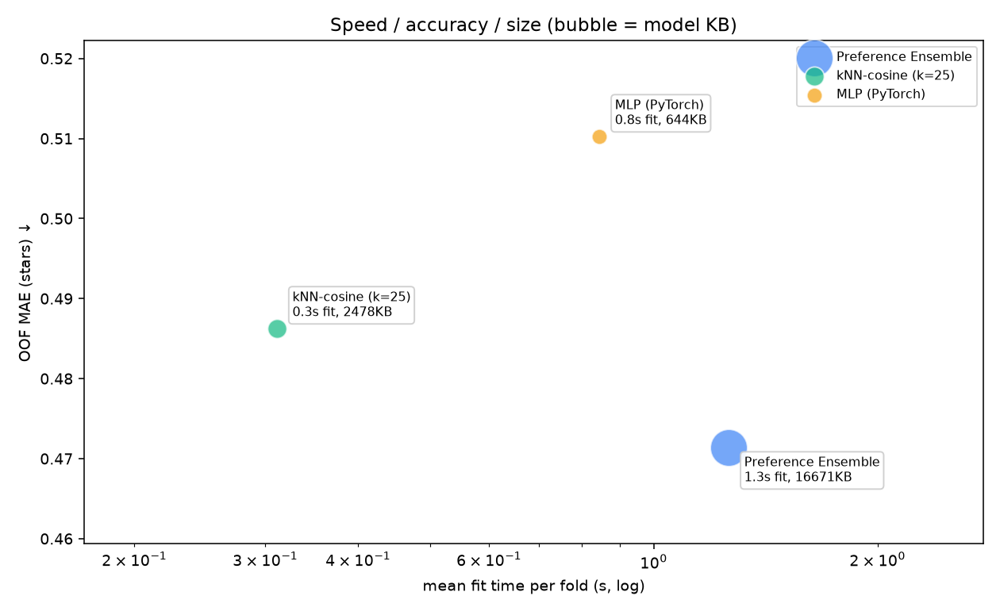
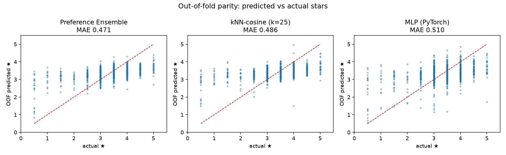

# Rating Challenger Report

Same data (1239 ratings, 512-dim MuQ-MuLan), same 5 folds (seed 42).
MLflow experiment: `kolo-rating-challengers` / run `challenger_comparison` (cuda).

| Model | MAE ↓ | RMSE ↓ | ±0.5★ ↑ | Pearson ↑ | fit/fold ↓ | size ↓ |
|---|---:|---:|---:|---:|---:|---:|
| Preference Ensemble | 0.471 | 0.653 | 66.3% | 0.525 | 1.3s | 16671KB |
| kNN-cosine (k=25) | 0.486 | 0.679 | 65.7% | 0.465 | 0.3s | 2478KB |
| MLP (PyTorch) | 0.510 | 0.696 | 63.3% | 0.433 | 0.8s | 644KB |

**Most accurate: Preference Ensemble (MAE 0.471).**

## Plots

