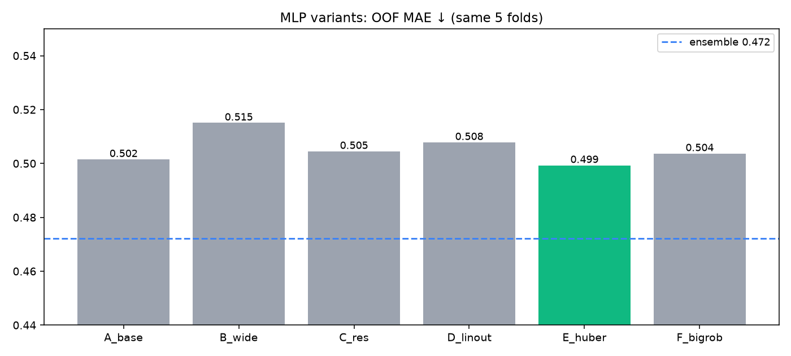
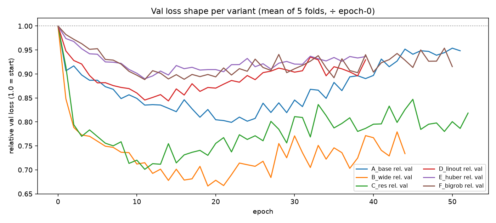

# MLP Iteration Report

Same data (1243 ratings), same 5 folds (seed 42).

| Variant | MAE ↓ | ±0.5★ ↑ | Pearson ↑ | train time |
|---|---:|---:|---:|---:|
| A_base | 0.502 | 62.1% | 0.463 | 5s |
| B_wide | 0.515 | 62.3% | 0.430 | 3s |
| C_res | 0.505 | 61.9% | 0.403 | 5s |
| D_linout | 0.508 | 61.7% | 0.471 | 3s |
| E_huber | 0.499 | 61.8% | 0.466 | 3s |
| F_bigrob | 0.504 | 61.9% | 0.461 | 4s |
| **Ensemble (ref)** | **0.472** | **66.0%** | **0.526** | — |

**Best MLP: E_huber (MAE 0.499).**

